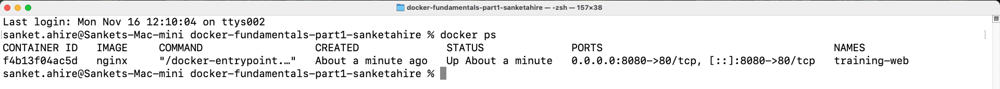
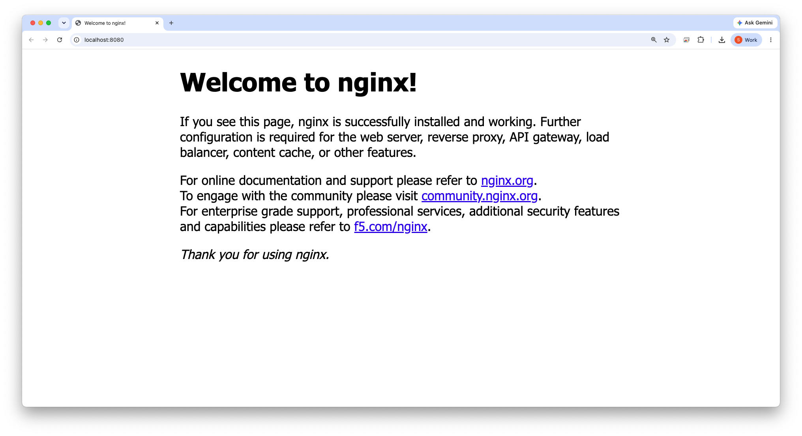
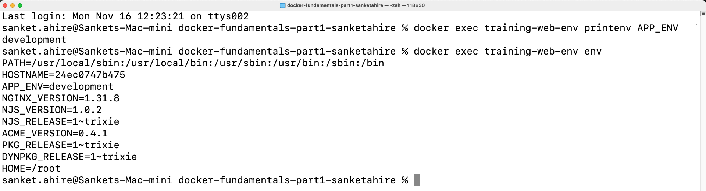
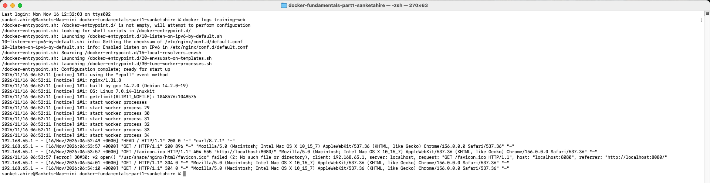
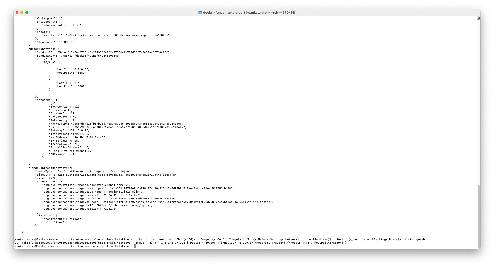
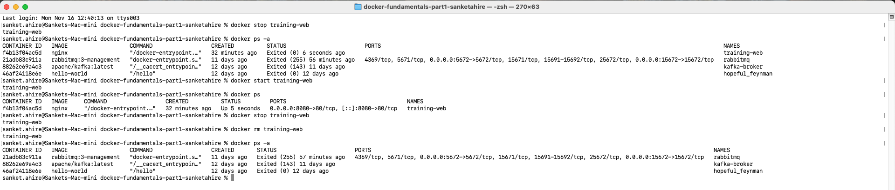

# Docker Training — Part 1: Solution Report

**Author:** Sanket Ahire  
**Assignment:** Docker Fundamentals [Part 1]  

---

## Executive Summary

This report documents the step-by-step practical execution, verification, and analysis of the containerization tasks specified in `Training.Assignment.Docker.Part1.pdf`. All tasks adhere to the containerization principles, architecture models, and operational guidelines detailed in `Training.Material.Docker.Part1.pdf`.

### Solution Roadmap & Progress Matrix

| Task | Title | Key Objective | Status | Evidence Deliverable |
| :---: | :--- | :--- | :---: | :--- |
| **1** | **Obtain the Docker Image** | Search, pull, and verify official `nginx:latest` | **Completed** | [01_docker_images_nginx.png](screenshots/01_docker_images_nginx.png) |
| **2** | **Run the Web Server** | Run `training-web` detached with port forwarding | **Completed** | [02_docker_ps_running.png](screenshots/02_docker_ps_running.png), [03_nginx_browser_access.png](screenshots/03_nginx_browser_access.png) |
| **3** | **Runtime Configuration** | Inject environment variables (`APP_ENV=development`) | **Completed** | [04_env_variable_verification.png](screenshots/04_env_variable_verification.png) |
| **4** | **Explore Container** | Inspect logs, in-container exec, and 5 metadata fields | **Completed** | [05_docker_logs.png](screenshots/05_docker_logs.png),<br>[06a_docker_inspect_overview.png](screenshots/06a_docker_inspect_overview.png),<br>[06b_docker_inspect_hostconfig.png](screenshots/06b_docker_inspect_hostconfig.png),<br>[06c_docker_inspect_env_config.png](screenshots/06c_docker_inspect_env_config.png),<br>[06d_docker_inspect_network_format.png](screenshots/06d_docker_inspect_network_format.png) |
| **5** | **Lifecycle Management** | Sequence: `Running` $\rightarrow$ `Stopped` $\rightarrow$ `Started` $\rightarrow$ `Removed` | **Completed** | [07_container_lifecycle_states.png](screenshots/07_container_lifecycle_states.png) |

---

## Task 1: Obtain the Docker Image

### 1.1 Objective
Search Docker Hub for the official Nginx image, pull the image to the local Docker engine cache, and verify its presence and integrity.

### 1.2 Theoretical Principle Applied
* **Registries & Trust:** Docker Hub hosts both *Official Images* (curated by Docker and upstream maintainers) and *Community Images*. The official `nginx` image provides a secure, minimal, and standardized web server runtime.
* **Tagging Defaults:** If no tag is explicitly provided, Docker defaults to `:latest`. Explicitly requesting `nginx:latest` ensures determinism.
* **Layer Caching:** Docker pulls multi-layered images by downloading each immutable content-addressable layer (`sha256`), which is subsequently cached locally for instant reuse.

### 1.3 Executed Commands & Outputs

#### Step 1: Pull the official Nginx image
```bash
docker pull nginx:latest
```

**Terminal Output:**
```text
latest: Pulling from library/nginx
1724c05f72c6: Pull complete 
7cb4701ce7cd: Pull complete 
6d2e43921e9e: Pull complete 
bbb080c71d50: Pull complete 
1962e1ff75b4: Pull complete 
37fb86c2a767: Pull complete 
512ac5e7ce8e: Pull complete 
Digest: sha256:165ddde8751e75a1c907d24ef10d9f6deb08b57e0fe56caf67512486aff76d82
Status: Downloaded newer image for nginx:latest
docker.io/library/nginx:latest
```

#### Step 2: Verify local image presence
```bash
docker images
```

**Terminal Output:**
```text
IMAGE                   ID             DISK USAGE   CONTENT SIZE   EXTRA
apache/kafka:latest     77e3df905404        686MB          239MB    U   
hello-world:latest      c567b231f656       25.9kB         9.49kB    U   
nginx:latest            165ddde8751e        243MB         66.8MB        
rabbitmq:3-management   e582c0bc7766        392MB          118MB    U   
```

### 1.4 Visual Evidence Deliverable
The official image `nginx:latest` (Image ID `165ddde8751e`) is successfully downloaded and registered in the local Docker image store:


---

## Task 2: Run the Web Server

### 2.1 Objective
Instantiate an Nginx container named `training-web` in detached background mode, map host port `8080` to container port `80`, and verify that the default web application is accessible via browser and HTTP clients.

### 2.2 Theoretical Principles Applied
* **Detached Execution (`-d`):** Unlike foreground attached mode which binds the current terminal to standard I/O streams and stops the container upon `Ctrl + C`, detached mode tells the Docker Daemon to run the container process in the background and immediately output the container ID.
* **Deterministic Container Naming (`--name`):** By default, Docker assigns random memorable names (`adoring_turing`). Assigning `--name training-web` ensures reliable addressing for logging, inspection, execution, and lifecycle commands.
* **Network Bridging & Port Mapping (`-p <host-port>:<container-port>`):** Docker containers exist inside isolated network namespaces with private IP addresses unreachable directly from outside the host. Port mapping configures NAT forwarding rules in the Docker bridge network, bridging incoming host traffic on port `8080` to the internal Nginx daemon listening on port `80`.

### 2.3 Executed Commands & Outputs

#### Step 1: Start the container in detached mode with port mapping
```bash
docker run -d --name training-web -p 8080:80 nginx
```

**Terminal Output:**
```text
f4b13f04ac5dcb1c9efc719880235c7adb1ea6006408f5636f198c6740b03e93
```

#### Step 2: Verify active container status
```bash
docker ps
```

**Terminal Output:**
```text
CONTAINER ID   IMAGE     COMMAND                  CREATED          STATUS          PORTS                                     NAMES
f4b13f04ac5d   nginx     "/docker-entrypoint.…"   14 seconds ago   Up 13 seconds   0.0.0.0:8080->80/tcp, [::]:8080->80/tcp   training-web
```

#### Step 3: Verify HTTP connectivity and response headers
```bash
curl -I http://localhost:8080
```

**Terminal Output:**
```text
HTTP/1.1 200 OK
Server: nginx/1.31.8
Date: Mon, 16 Nov 2026 06:52:49 GMT
Content-Type: text/html
Content-Length: 896
Last-Modified: Wed, 21 Oct 2026 14:24:51 GMT
Connection: keep-alive
ETag: "6ad8cb33-380"
Accept-Ranges: bytes
```

### 2.4 Visual Evidence Deliverables

#### Evidence 2A: Active Running Container Status
The terminal execution of `docker ps` verifies that `training-web` is running in detached mode with active port forwarding (`0.0.0.0:8080->80/tcp`):



#### Evidence 2B: Application Access from Web Browser
Opening `http://localhost:8080` in the browser renders the default **"Welcome to nginx!"** landing page, proving successful end-to-end host-to-container network routing:



---

## Task 3: Configure the Container Using an Environment Variable

### 3.1 Objective
Demonstrate runtime configuration decoupling by launching a separate container from the same `nginx` image, dynamically passing the environment variable `APP_ENV=development` via `-e`, and verifying its active presence inside the running container namespace.

### 3.2 Theoretical Principles Applied
* **Separation of Code and Configuration (12-Factor App):** Rather than building environment-specific Docker images (e.g., separate images for dev, test, and production), modern containerization adheres to the principle of single, immutable image artifacts. Dynamic runtime variables adjust application behavior per environment without rebuilding.
* **Dynamic Variable Injection (`-e <KEY>=<VALUE>`):** The Docker Engine injects specified key-value pairs into the container's environment space at process spawn time.
* **In-Container Verification (`docker exec`):** Using `docker exec` allows non-disruptive execution of diagnostic commands (`printenv` and `env`) directly within the container's process namespace.

### 3.3 Executed Commands & Outputs

#### Step 1: Run a second container with runtime environment variable
```bash
docker run -d --name training-web-env -e APP_ENV=development nginx
```

**Terminal Output:**
```text
24ec0747b475ea326e905073b16be4fd8289ea76787bf88af364c6b8037eb2ba
```

#### Step 2: Verify specific variable existence via in-container execution
```bash
docker exec training-web-env printenv APP_ENV
```

**Terminal Output:**
```text
development
```

#### Step 3: Inspect complete container environment
```bash
docker exec training-web-env env
```

**Terminal Output:**
```text
PATH=/usr/local/sbin:/usr/local/bin:/usr/sbin:/usr/bin:/sbin:/bin
HOSTNAME=24ec0747b475
APP_ENV=development
NGINX_VERSION=1.31.8
NJS_VERSION=1.0.2
NJS_RELEASE=1~trixie
ACME_VERSION=0.4.1
PKG_RELEASE=1~trixie
DYNPKG_RELEASE=1~trixie
HOME=/root
```

#### Step 4: Auxiliary container cleanup
Once verification was completed, the secondary container was cleanly decommissioned to maintain zero resource clutter:
```bash
docker stop training-web-env && docker rm training-web-env
```

### 3.4 Visual Evidence Deliverable
The terminal execution below confirms that `APP_ENV=development` was successfully passed and is actively accessible inside the container environment:



---

## Task 4: Explore the Running Container

### 4.1 Objective
Perform deep container observability and administrative inspection on the running `training-web` container:
1. Examine container logs.
2. Verify active process status.
3. Execute an administrative command inside the live container without interrupting web traffic.
4. Extract and document the 5 mandatory metadata attributes: Container ID, Image Used, Port Mapping, Environment Variables, and Assigned Bridge IP Address.

### 4.2 Theoretical Principles Applied
* **Standard Output Logging (`docker logs`):** In modern container architecture, applications write diagnostic and access logs to `stdout` and `stderr`. Docker's logging driver intercepts these streams, enabling non-invasive log aggregation and real-time monitoring (`-f`, `--tail`).
* **Non-Disruptive Process Execution (`docker exec`):** While `docker run` instantiates a brand new container, `docker exec` attaches an auxiliary process to the existing Linux namespaces (PID, mount, network) of a running container, allowing runtime troubleshooting without restarting or altering PID 1.
* **Declarative Metadata Architecture (`docker inspect`):** Docker persists container state as a unified JSON document. Utilizing Go template syntax (`--format '{{ ... }}'`) allows precise, programmatic extraction of nested attributes (e.g., network settings and ports) without parsing large raw text outputs.

### 4.3 Executed Commands & Outputs

#### Step 1: View container logs
```bash
docker logs training-web
```

**Terminal Output:**
```text
/docker-entrypoint.sh: /docker-entrypoint.d/ is not empty, will attempt to perform configuration
/docker-entrypoint.sh: Looking for shell scripts in /docker-entrypoint.d/
/docker-entrypoint.sh: Launching /docker-entrypoint.d/10-listen-on-ipv6-by-default.sh
10-listen-on-ipv6-by-default.sh: info: Enabled listen on IPv6 in /etc/nginx/conf.d/default.conf
/docker-entrypoint.sh: Configuration complete; ready for start up
2026/11/16 06:52:11 [notice] 1#1: nginx/1.31.8
2026/11/16 06:52:11 [notice] 1#1: start worker processes
192.168.65.1 - - [16/Nov/2026:06:52:49 +0000] "HEAD / HTTP/1.1" 200 0 "-" "curl/8.7.1" "-"
192.168.65.1 - - [16/Nov/2026:06:53:57 +0000] "GET / HTTP/1.1" 200 896 "-" "Mozilla/5.0 ... Chrome/..."
192.168.65.1 - - [16/Nov/2026:06:54:01 +0000] "GET / HTTP/1.1" 304 0 "-" "Mozilla/5.0 ... Chrome/..."
```

#### Step 2: Check current container status
```bash
docker ps
```

**Terminal Output:**
```text
CONTAINER ID   IMAGE     COMMAND                  CREATED          STATUS          PORTS                                     NAMES
f4b13f04ac5d   nginx     "/docker-entrypoint.…"   25 minutes ago   Up 25 minutes   0.0.0.0:8080->80/tcp, [::]:8080->80/tcp   training-web
```

#### Step 3: Execute an in-container filesystem command
```bash
docker exec training-web ls -la /usr/share/nginx/html
```

**Terminal Output:**
```text
total 16
drwxr-xr-x 2 root root 4096 Nov  5 07:17 .
drwxr-xr-x 3 root root 4096 Nov  5 07:17 ..
-rw-r--r-- 1 root root  497 Oct 21 14:24 50x.html
-rw-r--r-- 1 root root  896 Oct 21 14:24 index.html
```

#### Step 4: Extract and identify the 5 mandatory metadata attributes
Using targeted Go template formatting on `docker inspect training-web`:

```bash
docker inspect --format 'ID: {{.Id}} | Image: {{.Config.Image}} | IP: {{.NetworkSettings.Networks.bridge.IPAddress}} | Ports: {{json .NetworkSettings.Ports}}' training-web
```

**Extracted Attributes Summary:**

| # | Attribute | Extraction Template | Identified Value |
| :-: | :--- | :--- | :--- |
| **1** | **Container ID** | `{{ .Id }}` | `f4b13f04ac5dcb1c9efc719880235c7adb1ea6006408f5636f198c6740b03e93` (short: `f4b13f04ac5d`) |
| **2** | **Image Used** | `{{ .Config.Image }}` | `nginx` (digest: `sha256:165ddde8751e...`) |
| **3** | **Port Mapping** | `{{ json .NetworkSettings.Ports }}` | `80/tcp` $\rightarrow$ `0.0.0.0:8080`, `[::]:8080` |
| **4** | **Environment Variables** | `{{ json .Config.Env }}` | `["PATH=...","NGINX_VERSION=1.31.8","NJS_VERSION=1.0.2","ACME_VERSION=0.4.1",...]` |
| **5** | **Container IP Address** | `{{ .NetworkSettings.Networks.bridge.IPAddress }}` | `172.17.0.2` (Default bridge network) |

### 4.4 Visual Evidence Deliverables

#### Evidence 4A: Container Logs Output
The terminal output demonstrates log capture through `docker logs training-web`, showing both daemon startup and live incoming HTTP GET/HEAD requests:



#### Evidence 4B: Targeted Container Inspection & Extracted Properties
The terminal capture below shows both the NetworkSettings structure and the concise `--format` template output confirming the 5 extracted metadata properties:



*(Additional reference inspect captures documenting full JSON sections: [Overview](screenshots/06a_docker_inspect_overview.png), [HostConfig](screenshots/06b_docker_inspect_hostconfig.png), [EnvConfig](screenshots/06c_docker_inspect_env_config.png)).*

---

## Task 5: Container Lifecycle Management

### 5.1 Objective
Methodically manage and document the complete container lifecycle of `training-web`:
1. Stop the running container and verify the `Exited` status.
2. Re-start the existing container and verify that web traffic resumes without issue.
3. Stop and permanently remove the container.
4. Verify complete non-existence in Docker's process table.

### 5.2 Theoretical Principles Applied
* **Graceful Termination vs. Force Termination (`docker stop` vs. `docker rm -f`):** Executing `docker stop` sends a `SIGTERM` signal to the container's primary process (PID 1), allowing it to finish in-flight requests and cleanly close file descriptors before Docker sends a `SIGKILL`. Force removal (`docker rm -f`) terminates the process abruptly. Best practices dictate graceful stoppage before removal.
* **State Persistence in Stopped (`Exited`) Containers:** When a container stops, its process ceases execution, but its dedicated **Writable Layer** and assigned configuration remain completely preserved on disk. It can be re-activated at any time via `docker start` with its network configuration and file changes intact.
* **Permanent Destruction (`docker rm`):** The `docker rm` command permanently deletes the container's writable layer and deregisters its metadata from the daemon. A removed container cannot be started again; it must be recreated from its base image.
* **The Lifecycle State Flow:**
  $$\text{Created} \longrightarrow \text{Running} \longrightarrow \text{Exited (Stopped)} \longrightarrow \text{Running (Started)} \longrightarrow \text{Removed}$$

### 5.3 Executed Commands & Outputs

#### Step 1: Stop the running container
```bash
docker stop training-web
```

**Terminal Output:**
```text
training-web
```

#### Step 2: Verify container is in Exited state
```bash
docker ps -a
```

**Terminal Output:**
```text
CONTAINER ID   IMAGE     COMMAND                  CREATED          STATUS                    PORTS     NAMES
f4b13f04ac5d   nginx     "/docker-entrypoint.…"   32 minutes ago   Exited (0) 6 seconds ago             training-web
```

#### Step 3: Start the stopped container again
```bash
docker start training-web
```

**Terminal Output:**
```text
training-web
```

#### Step 4: Verify container resumed running state
```bash
docker ps
```

**Terminal Output:**
```text
CONTAINER ID   IMAGE     COMMAND                  CREATED          STATUS         PORTS                                     NAMES
f4b13f04ac5d   nginx     "/docker-entrypoint.…"   32 minutes ago   Up 5 seconds   0.0.0.0:8080->80/tcp, [::]:8080->80/tcp   training-web
```

#### Step 5: Stop and permanently remove the container
```bash
docker stop training-web
docker rm training-web
```

**Terminal Output:**
```text
training-web
training-web
```

#### Step 6: Verify complete non-existence in process table
```bash
docker ps -a
```

**Terminal Output:**
```text
CONTAINER ID   IMAGE                   COMMAND                  CREATED       STATUS                        PORTS     NAMES
21adb83c911a   rabbitmq:3-management   "docker-entrypoint.s…"   11 days ago   Exited (255) 57 minutes ago             rabbitmq
88262e69a4c3   apache/kafka:latest     "/__cacert_entrypoin…"   12 days ago   Exited (143) 11 days ago                kafka-broker
46af24118e6e   hello-world             "/hello"                 12 days ago   Exited (0) 12 days ago                  hopeful_feynman
```
*(Notice: `training-web` is completely absent from all active and stopped container records).*

### 5.4 Visual Evidence Deliverable
The terminal execution below captures the continuous sequence demonstrating all four states: **Running $\rightarrow$ Stopped (`Exited`) $\rightarrow$ Started (`Up`) $\rightarrow$ Removed**:



---

## 6. Comprehensive Docker Command Reference

To satisfy the **Deliverables: Docker Commands** requirement of the assignment, the table below provides a consolidated summary of all commands utilized across the five tasks:

| Operational Category | Exact Command Executed | Purpose & Key Options |
| :--- | :--- | :--- |
| **Pulling Image (Task 1)** | `docker pull nginx:latest` | Downloads official image layers from Docker Hub. |
| **Verifying Image (Task 1)** | `docker images` | Lists cached images, IDs, sizes, and tags. |
| **Running Container (Task 2)** | `docker run -d --name training-web -p 8080:80 nginx` | `-d`: background mode, `--name`: custom name, `-p`: port mapping host `8080` to container `80`. |
| **Verifying Service (Task 2)** | `docker ps` | Lists running containers, uptime, and mapped ports. |
| **Runtime Config (Task 3)** | `docker run -d --name training-web-env -e APP_ENV=development nginx` | `-e`: dynamic environment variable injection at container instantiation. |
| **Verifying Config (Task 3)** | `docker exec training-web-env printenv APP_ENV` | Reads environment variable inside live container. |
| **Viewing Logs (Task 4)** | `docker logs training-web` | Displays `stdout`/`stderr` startup and HTTP request logs. |
| **In-Container Exec (Task 4)**| `docker exec training-web ls -la /usr/share/nginx/html` | Executes non-intrusive command in live container namespace. |
| **Inspecting Container (Task 4)**| `docker inspect training-web` | Queries complete container configuration and state JSON. |
| **Targeted Inspection (Task 4)**| `docker inspect --format '...' training-web` | Uses Go templates to isolate ID, Image, IP, and Ports. |
| **Stopping Container (Task 5)**| `docker stop training-web` | Gracefully stops the container with `SIGTERM`. |
| **Verifying Stopped (Task 5)**| `docker ps -a` | Lists all containers including `Exited` status. |
| **Starting Container (Task 5)**| `docker start training-web` | Re-spawns existing container retaining writable layer. |
| **Removing Container (Task 5)**| `docker rm training-web` | Permanently deletes container and writable layer. |


