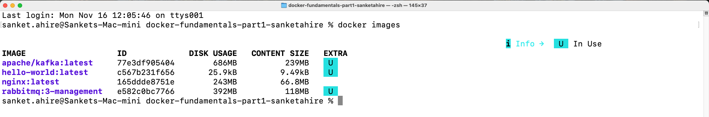

# Docker Training — Part 1: Solution Report

**Author:** Sanket Ahire  
**Assignment:** Docker Fundamentals [Part 1]  

---

## Executive Summary

This report documents the step-by-step practical execution, verification, and analysis of the containerization tasks specified in `Training.Assignment.Docker.Part1.pdf`. All tasks adhere to the containerization principles, architecture models, and operational guidelines detailed in `Training.Material.Docker.Part1.pdf`.

### Solution Roadmap & Progress Matrix

| Task | Title | Key Objective | Status | Evidence Deliverable |
| :---: | :--- | :--- | :---: | :--- |
| **1** | **Obtain the Docker Image** | Search, pull, and verify official `nginx:latest` | **Completed** | [01_docker_images_nginx.png](screenshots/01_docker_images_nginx.png) |
| **2** | **Run the Web Server** | Run `training-web` detached with port forwarding | **In Progress** | *To be captured upon execution* |
| **3** | **Runtime Configuration** | Inject environment variables (`APP_ENV=development`) | **Pending** | *Pending execution* |
| **4** | **Explore Container** | Inspect logs, in-container exec, and 5 metadata fields | **Pending** | *Pending execution* |
| **5** | **Lifecycle Management** | Sequence: `Running` $\rightarrow$ `Stopped` $\rightarrow$ `Started` $\rightarrow$ `Removed` | **Pending** | *Pending execution* |

---

## Task 1: Obtain the Docker Image

### 1.1 Objective
Search Docker Hub for the official Nginx image, pull the image to the local Docker engine cache, and verify its presence and integrity.

### 1.2 Theoretical Principle Applied
* **Registries & Trust:** Docker Hub hosts both *Official Images* (curated by Docker and upstream maintainers) and *Community Images*. The official `nginx` image provides a secure, minimal, and standardized web server runtime.
* **Tagging Defaults:** If no tag is explicitly provided, Docker defaults to `:latest`. Explicitly requesting `nginx:latest` ensures determinism.
* **Layer Caching:** Docker pulls multi-layered images by downloading each immutable content-addressable layer (`sha256`), which is subsequently cached locally for instant reuse.

### 1.3 Executed Commands & Outputs

#### Step 1: Pull the official Nginx image
```bash
docker pull nginx:latest
```

**Terminal Output:**
```text
latest: Pulling from library/nginx
1724c05f72c6: Pull complete 
7cb4701ce7cd: Pull complete 
6d2e43921e9e: Pull complete 
bbb080c71d50: Pull complete 
1962e1ff75b4: Pull complete 
37fb86c2a767: Pull complete 
512ac5e7ce8e: Pull complete 
Digest: sha256:165ddde8751e75a1c907d24ef10d9f6deb08b57e0fe56caf67512486aff76d82
Status: Downloaded newer image for nginx:latest
docker.io/library/nginx:latest
```

#### Step 2: Verify local image presence
```bash
docker images
```

**Terminal Output:**
```text
IMAGE                   ID             DISK USAGE   CONTENT SIZE   EXTRA
apache/kafka:latest     77e3df905404        686MB          239MB    U   
hello-world:latest      c567b231f656       25.9kB         9.49kB    U   
nginx:latest            165ddde8751e        243MB         66.8MB        
rabbitmq:3-management   e582c0bc7766        392MB          118MB    U   
```

### 1.4 Visual Evidence Deliverable
The official image `nginx:latest` (Image ID `165ddde8751e`) is successfully downloaded and registered in the local Docker image store:


